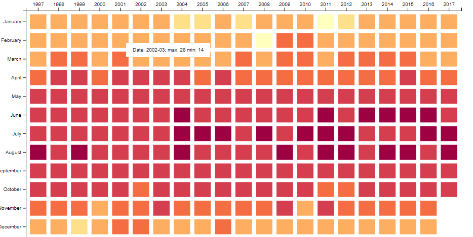

# CSCE-679-Data-Visualization-Assignment1

## Level 1 & 2 (Basic): [Link](./level1.md)
HK Temperature Heatmap


## Grading:
1. Correctness (50%): The data visualizations generated should look the same.
2. Redability (30%): The code should be human-readable (i.e., the name of the variables and functions should be intuitive, and there should be enough comments).
3. Maintainability (20%): The code should be modulized and easily modified.

## Submission:

Please create a github repository under your github account, and submit the URL of that repository to Canvas.

## Solution

| Page | What it shows |
|---|---|
| [level1.html](./level1.html) | Year/month heatmap of the monthly max or min temperature, 1997–2017 |
| [level2.html](./level2.html) | Same heatmap for 2008–2017, with daily max/min line charts inside each cell |

### Running locally
Browsers block loading the CSV from a page opened directly from disk, so serve the folder first:

```bash
python -m http.server 8000
```

Then open <http://localhost:8000/level1.html> or <http://localhost:8000/level2.html>.

### Interaction
- **Hover** a cell to see its date and monthly max/min temperature.
- **Click** a cell, or use the *Max / Min temperature* buttons, to switch what the colour shows.
- Hover a legend swatch to see the exact temperature range it covers.

### Code structure
Built with [D3 v7](https://d3js.org/), loaded from a CDN, with no build step.

```
js/config.js       every tunable setting: data columns, sizes, colours, spacing, year range
js/data.js         load the CSV and aggregate daily rows into monthly records
js/colorScale.js   temperature -> colour (quantized Spectral palette)
js/heatmap.js      year x month matrix with axes and tooltips (shared by both levels)
js/sparkline.js    daily max/min mini line charts drawn inside each cell (Level 2)
js/legend.js       colour legend and sparkline key
js/tooltip.js      floating tooltip and its text format
js/controls.js     Max/Min toggle buttons, year-range heading, data-load error message
js/heatmapPage.js  page flow shared by both levels (load -> draw -> legend -> toggle)
js/level1.js       entry point for level1.html
js/level2.js       entry point for level2.html (adds sparklines to the shared page)
css/style.css      shared styles
```

### Customising
All settings live in [`js/config.js`](./js/config.js). For example:
- Change `LEVEL2_LAYOUT.yearsToShow` to show 5 instead of 10 years.
- Change `COLOR.palette` or `COLOR.domain` to use a different colour scheme or range.
- Add an entry to `TEMPERATURE_MODES` (e.g. a monthly mean) and a new toggle button appears automatically.
- Point `DATA.path` and `DATA.columns` at another CSV with the same shape.
